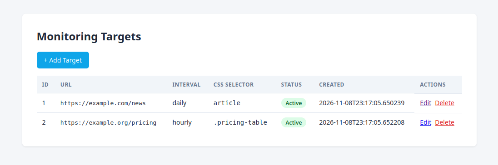

# Monitor App - Java CRUD Module

A minimal Java web application demonstrating **JDBC-based CRUD** for the
`MonitoringTarget` entity, exposed through **Jakarta Servlets and JSP**.

## What You Will See
A single-page management interface for monitoring targets:

- **List** all targets in a table
- **Create** a new target via a form
- **Edit** an existing target
- **Delete** a target (with confirmation)
- Flash messages confirm each successful operation
- Two example rows are seeded on first run by default

## Screenshot



## Prerequisites

| Software | Version | Notes |
|----------|---------|-------|
| JDK      | 17      | `sudo apt install openjdk-17-jdk` |
| Maven    | 3.8+    | `sudo apt install maven` |
| Tomcat   | 10.1+   | Jakarta Servlet 6.0 — Tomcat 9 will **not** work |

## How do I run it?
```bash
# 1. Build the WAR
mvn clean package

# 2. Stop Tomcat if already running, then deploy
$CATALINA_HOME/bin/shutdown.sh 2>/dev/null
rm -rf $CATALINA_HOME/webapps/website-change-detector*
cp target/website-change-detector.war $CATALINA_HOME/webapps/

# 3. Start Tomcat
$CATALINA_HOME/bin/startup.sh
```

Open http://localhost:8080/website-change-detector/

You will be redirected to /targets and should see two seeded rows:
https://example.com/news and https://example.org/pricing.
